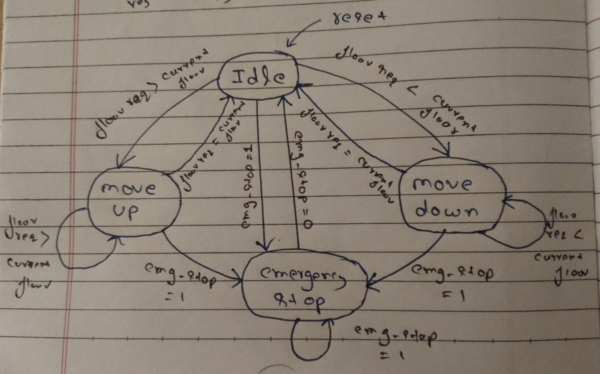
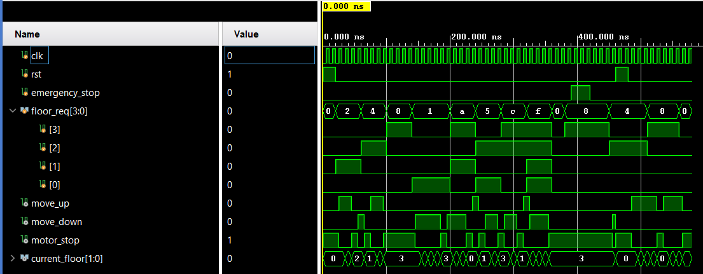
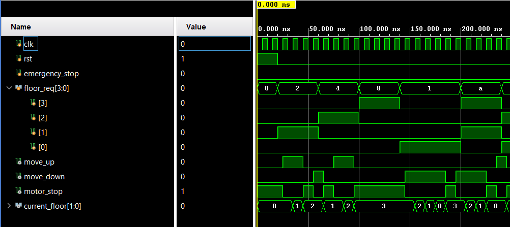
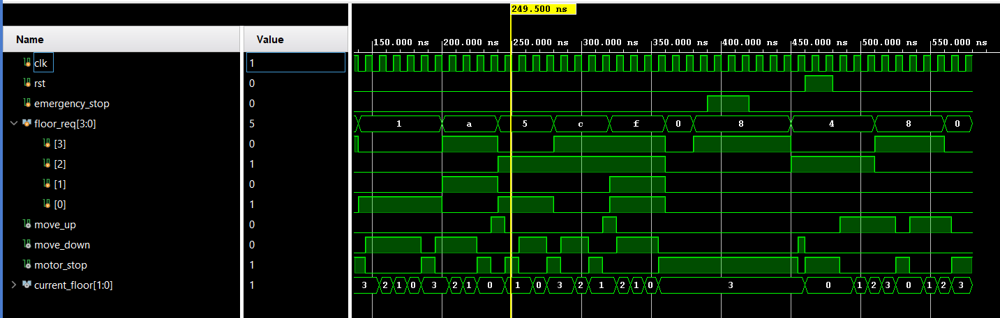

# Elevator Controller

A four-floor elevator controller designed using Verilog HDL. It uses a Finite State Machine (FSM) to control elevator movement, handle floor requests, and respond to emergency-stop signals.

## Features

- 4 floors (Floor 0 to Floor 3)
- 4 FSM states: Idle, Move Up, Move Down, and Emergency Stop
- 4-bit floor request input
- Up and down movement control
- Motor-stop control
- Reset and emergency-stop functionality
- Priority-based floor selection

## Files

- `elevator_controller.v` - the elevator controller module
- `elevator_controller_tb.v` - testbench

## Tools

Xilinx Vivado (XSim) for simulation

## FSM Diagram

## Simulation Waveform

