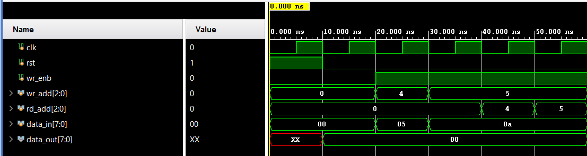

# 8x8 RAM

A basic 8x8 RAM designed using Verilog HDL. It stores 8 data words, with each word having 8 bits. Data can be written to and read from different memory addresses.

## Features

- 8 memory locations
- 8-bit data width
- 3-bit read and write addresses
- Write enable control
- Reset functionality
- Synchronous read and write operations

## Files

- `RAM_8x8.v` - the RAM module
- `RAM_8x8_tb.v` - testbench

## Tools

Xilinx Vivado (XSim) for simulation

## Simulation Waveform

